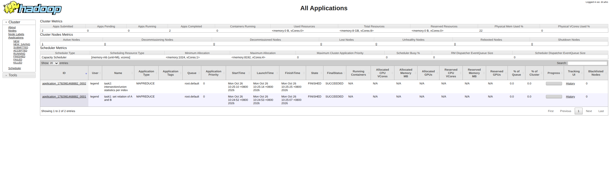

# 作业5：MapReduce 求成分股集合关系与交集/并集统计

## 一、题目概述

给定两个输入文件 `A.txt`、`B.txt`，文件内包含纳斯达克100指数、标普500指数、道琼斯工业指数的部分成分股数据。每行两列，第一列为三大指数编号（简化为 `101`、`102`、`103`），第二列为成分股代码，列间以制表符或空格分隔。

需要编写 MapReduce 程序完成两个任务：

- **任务1**：求每个指数下 A 与 B 的成分股集合关系，对每个 `(指数编号, 股票代码)` 判断其属于 `BOTH`（同时出现）、`A_ONLY`（仅 A）、`B_ONLY`（仅 B）。
- **任务2**：对任务1结果进行二次统计，输出每个指数的交集数量（BOTH）、A 独有数量（A_ONLY）、B 独有数量（B_ONLY）以及并集数量。

同一文件内重复的股票代码只计算一次。

## 二、设计思路

全部代码集中在 [src/main/java/hwk5/StockSetAnalysis.java](src/main/java/hwk5/StockSetAnalysis.java) 中，通过一个 Driver 串联两个 Job。

### 任务1：集合关系判定（SetRelationMapper / SetRelationReducer）

1. **数据来源标记**：Mapper 通过 `FileSplit` 获取当前切片的文件名，文件名以 `A` 开头则标记来源为 `A`，否则标记为 `B`。这样无需额外改动输入，即可在同一 Mapper 中区分两份来源数据，实现"同一 `(指数, 股票)` 键上合并两份来源"的集合运算。
2. **键值设计**：以 `指数编号 \t 股票代码` 作为 Map 输出 key，value 为来源标签 `A` / `B`。
3. **Reduce 判定**：Reducer 收到同一 `(指数, 股票)` 下所有来源标签后，用两个布尔变量 `inA`、`inB` 记录是否出现过 A/B，据此输出 `BOTH` / `A_ONLY` / `B_ONLY`。输出 key 仍为 `指数编号 \t 股票代码`，value 为关系标记。

输出结果天然按 `指数编号`、`股票代码` 升序排列（MapReduce 框架对 key 排序）。

### 任务2：交集/差集/并集统计（SetStatsMapper / SetStatsReducer）

1. **二次读取**：Mapper 读取任务1输出（格式 `指数编号 \t 股票代码 \t 关系`），只保留 `指数编号`（key）和 `关系标记`（value）。
2. **计数聚合**：Reducer 统计每个指数下 `BOTH` / `A_ONLY` / `B_ONLY` 的数量，并计算 `并集 = BOTH + A_ONLY + B_ONLY`，输出 `指数编号 \t 交集数量 \t A独有数量 \t B独有数量 \t 并集数量`。

### 关键设计点

- **单 Driver 串行执行**：`main` 中先提交任务1，`waitForCompletion(true)` 成功后再提交任务2，任务2直接以任务1的输出目录作为输入，形成一个两阶段的 MapReduce 流水线。
- **集合语义天然去重**：同一文件内重复的股票代码会以相同的 `(指数, 股票)` 键合并，Reducer 中布尔判断天然去重，满足"重复只计算一次"的要求。
- **来源识别不依赖文件名之外的信息**：通过输入切片的文件名区分 A/B，简单可靠。

## 三、运行方法

### 1. 编译打包

```bash
cd hwk5
mvn clean package -DskipTests
# 产物：target/hwk5-1.0.jar
```

### 2. 准备 HDFS 输入

```bash
hadoop fs -mkdir -p /user/$USER/hwk5/input
hadoop fs -put A.txt B.txt /user/$USER/hwk5/input/
```

### 3. 运行作业

```bash
hadoop jar target/hwk5-1.0.jar hwk5.StockSetAnalysis \
    /user/$USER/hwk5/input \
    /user/$USER/hwk5/output_task1 \
    /user/$USER/hwk5/output_task2
```

> 输出目录必须不存在，否则作业会因输出已存在而失败。可先 `hadoop fs -rm -r` 清理。

### 4. 查看结果

```bash
hadoop fs -cat /user/$USER/hwk5/output_task1/part-r-00000   # 任务1：集合关系
hadoop fs -cat /user/$USER/hwk5/output_task2/part-r-00000   # 任务2：交集/差集/并集统计
```

### 5. 一键运行脚本

也可直接使用本目录下的 [run.sh](run.sh) 一键完成打包、上传、运行与结果下载。

## 四、运行结果

### 任务1（`output/output_task1/part-r-00000`，共 547 行，节选）

```
101	AAPL	A_ONLY
101	AMGN	A_ONLY
101	JPM	BOTH
101	KO	B_ONLY
101	UNH	BOTH
101	V	BOTH
...
```

### 任务2（`output/output_task2/part-r-00000`，共 3 行，完整）

```
101	3	13	4	20
102	3	19	3	25
103	52	195	255	502
```

| 指数编号 | 交集数量(BOTH) | A独有(A_ONLY) | B独有(B_ONLY) | 并集 |
|:---:|:---:|:---:|:---:|:---:|
| 101 | 3 | 13 | 4 | 20 |
| 102 | 3 | 19 | 3 | 25 |
| 103 | 52 | 195 | 255 | 502 |

其中 `101`、`102` 两行与作业示例一致（`101 → 3 13 4 20`、`102 → 3 19 3 25`），`103` 为对给定数据的正确统计结果。

## 五、可能的改进之处

1. **去重前置**：当前依赖 Reduce 阶段对 `(指数, 股票)` 键的天然合并去重，若 A/B 文件中存在大量重复行，Map 端可先做 Combiner 或在 Mapper 内用 `HashSet` 去重，减少 shuffle 数据量。
2. **分区器优化**：目前使用默认 HashPartitioner，`(指数, 股票)` 会散列到多个 reducer。若数据规模增大，可自定义分区器按指数编号分区，使同一指数的数据落在同一 reducer，便于后续统计。
3. **任务2 可合并为单 Job**：任务2 的二次统计本质上是任务1 的聚合，可在任务1 Reducer 输出后直接由另一个 Reducer 级联处理；不过拆成两个 Job 更清晰、易于复现和调试。
4. **输入路径与文件名耦合**：来源判定依赖文件名以 `A` 开头。若输入文件名改变，可改为通过两个独立的 `FileInputFormat.addInputPath` 分别指定 A/B 目录，结合文件名白名单或路径前缀判断，鲁棒性更强。

## 六、运行成功截图

作业运行成功的 YARN ResourceManager Web 页面截图（`task1: set relation...` 与
`task2: intersection...` 两个作业均为 SUCCEEDED）：



